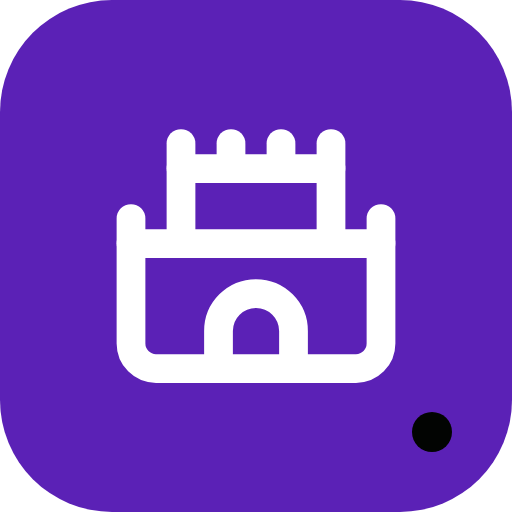
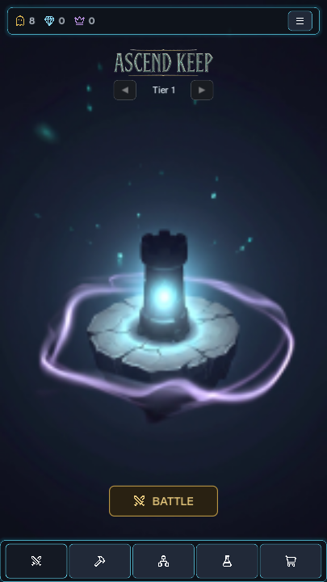
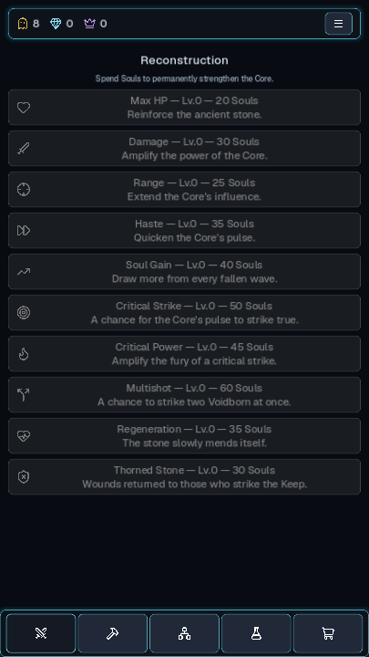
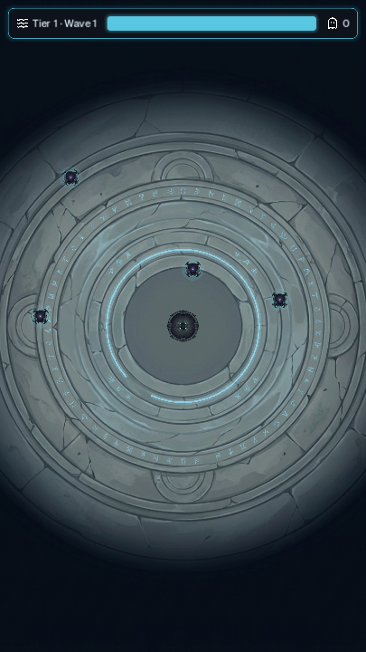

<p align="center">
  
</p>

<h1 align="center">AscendKeep</h1>

<p align="center">
  A tower defense for Android where losing is part of the plan.<br>
  <a href="#english">English</a> · <a href="#italiano">Italiano</a> · <a href="https://davide-mariotti.github.io/apps/ascendkeep/">Website</a> · <a href="docs/DESIGN.md">Design notes (IT)</a>
</p>

<p align="center">
  <a href="https://ko-fi.com/Z0X32ATNHL"></a>
</p>

<p align="center">
  
  
  
</p>

---

## English

The world was swallowed by the Void. The Keep is the last thing standing, and it isn't a building: it's alive, it remembers every fall,
and each time the Voidborn tear it down it absorbs their Souls and comes back stronger. You don't win AscendKeep. You come back better.

> **Status: in development.** Playable on desktop and on a debug Android build, not on the Play Store yet.

### What it does

- **Waves of Voidborn** walk to the Core and hit it; the Core shoots the closest one in range. Every cleared wave drops Souls.
- **Tiers** of 100 waves each, with a boss every 10 waves. Reach wave 50 and the next tier opens; old tiers stay replayable.
- **Permanent progression** between runs: 10 Reconstruction upgrades paid in Souls, a skill tree with 150 hand-written nodes
  paid in Skill Points (from bosses, plus one a day from an ad), 103 one-shot Lab researches.
- **Cloud save** on Firebase: an anonymous account by default. Google sign-in, to move to another phone, is wired in but not live yet.
- Sound effects, vibration, an intro you can skip and replay, a reset button that asks twice.

### What it doesn't do

- It doesn't show ads unless you tap "Watch an ad": the only ads are optional rewarded videos (Google AdMob).
- It doesn't sell power you can't earn by playing. The real-money items are Auto Restart, Remove Ads and two cosmetic Core skins.
- It doesn't run on iOS yet (it would need a Mac), and it isn't on the Play Store yet.
- It doesn't collect analytics or track you beyond what AdMob and Firebase need to work.
- It doesn't end. There are 100 tiers. Good luck.

### Run it

1. Install [Godot 4.7](https://godotengine.org/download) (standard, not .NET).
2. Open `project.godot` and press F5. On desktop, ads are replaced by the AdMob plugin's mock overlay and purchases do nothing.
3. Cloud save needs a Firebase config in `addons/godot-firebase/.env` (not in the repo: it holds the project keys).
4. For a real Android build: Android SDK and JDK, the AdMob native packages (`Project → Tools → AdMob Manager`) and, to sell anything,
   the four in-app products on Play Console. Everything is written down in [docs/DESIGN.md](docs/DESIGN.md).

### How it's organised

```
scenes/       Home (the hub with five tabs) and Main (the battle), Enemy, Projectile
scripts/      gameplay (Main, Tower, Enemy, Projectile), progression and save (Meta), Audio, Ads, Purchases, Backend
ui/           the shared theme (UITheme.tres): dark navy, cyan Core glow, Geist font
assets/       icons (Lucide), sprites, art, audio, fonts, app icon (assets/art/app-icon/, built by make-icons.py)
prompt/       the prompts used to generate the artwork
docs/         design notes, competitor analysis, screenshots
```

### Credits

- Engine: [Godot](https://godotengine.org) 4.7 (MIT).
- Icons: [Lucide](https://lucide.dev) (ISC). Font: [Geist](https://vercel.com/font) (OFL).
- Sound effects: Kenney and artisticdude via OpenGameArt (CC0).
- Plugins: AdMob by Poing Studios, Google Play Billing, GodotFirebase, GodotGoogleSignIn. Details in `assets/icons/CREDITS.md`.
- Core, Voidborn, boss and backgrounds are original artwork made for this game.

### Support

If the Keep ate an evening of yours, you can [buy me a coffee on Ko-fi](https://ko-fi.com/Z0X32ATNHL). The Core runs on Souls, I run on coffee.

### License

The code is [MIT](LICENSE). Artwork, story and names (AscendKeep, the Keep, the Voidborn) are mine: ask before reusing them.

---

## Italiano

Il mondo è stato inghiottito dal Vuoto. La Keep è l'ultima cosa ancora in piedi, e non è un edificio: è viva, ricorda ogni caduta,
e ogni volta che i Voidborn la abbattono assorbe le loro Souls e torna più forte. AscendKeep non si vince. Si ritorna più forti.

> **Stato: in sviluppo.** Si gioca su PC e su una build Android di debug, non è ancora sul Play Store.

### Cosa fa

- **Ondate di Voidborn** camminano verso il Core e lo colpiscono; il Core spara al più vicino nel raggio. Ogni ondata superata lascia Souls.
- **Tier** da 100 ondate, con un boss ogni 10. Alla wave 50 si apre il tier successivo; quelli vecchi restano rigiocabili.
- **Progressione permanente** tra una partita e l'altra: 10 potenziamenti di Reconstruction pagati in Souls, un albero delle skill con
  150 nodi scritti a mano pagati in Skill Points (dai boss, più una al giorno da una pubblicità), 103 ricerche del Lab.
- **Salvataggio online** su Firebase: account anonimo di base. L'accesso con Google, per passare a un altro telefono, è collegato ma non ancora attivo.
- Effetti sonori, vibrazione, un'intro che si salta e si riguarda, un reset che chiede conferma due volte.

### Cosa non fa

- Non mostra pubblicità se non tocchi "Watch an ad": le uniche sono video premiati facoltativi (Google AdMob).
- Non vende potenza che non puoi guadagnare giocando. Gli acquisti veri sono Auto Restart, Remove Ads e due skin estetiche del Core.
- Non gira ancora su iOS (servirebbe un Mac) e non è ancora sul Play Store.
- Non raccoglie statistiche né ti traccia oltre quello che serve ad AdMob e Firebase per funzionare.
- Non finisce. I tier sono 100. In bocca al lupo.

### Avviarlo

1. Installa [Godot 4.7](https://godotengine.org/download) (versione standard, non .NET).
2. Apri `project.godot` e premi F5. Su PC le pubblicità sono sostituite dalla finta pubblicità del plugin AdMob e gli acquisti non fanno nulla.
3. Il salvataggio online vuole la configurazione Firebase in `addons/godot-firebase/.env` (non è nella repo: contiene le chiavi del progetto).
4. Per una build Android vera: Android SDK e JDK, i pacchetti nativi di AdMob (`Project → Tools → AdMob Manager`) e, per vendere,
   i quattro prodotti in-app su Play Console. È tutto scritto in [docs/DESIGN.md](docs/DESIGN.md).

### Com'è organizzato

```
scenes/       Home (l'hub con cinque schede) e Main (la battaglia), Enemy, Projectile
scripts/      gameplay (Main, Tower, Enemy, Projectile), progressione e salvataggio (Meta), Audio, Ads, Purchases, Backend
ui/           il tema condiviso (UITheme.tres): blu notte, bagliore ciano del Core, font Geist
assets/       icone (Lucide), sprite, illustrazioni, audio, font, icona dell'app (assets/art/app-icon/, generata da make-icons.py)
prompt/       i prompt usati per generare le illustrazioni
docs/         note di design, analisi della concorrenza, schermate
```

### Riconoscimenti

- Motore: [Godot](https://godotengine.org) 4.7 (MIT).
- Icone: [Lucide](https://lucide.dev) (ISC). Font: [Geist](https://vercel.com/font) (OFL).
- Effetti sonori: Kenney e artisticdude via OpenGameArt (CC0).
- Plugin: AdMob di Poing Studios, Google Play Billing, GodotFirebase, GodotGoogleSignIn. Dettagli in `assets/icons/CREDITS.md`.
- Core, Voidborn, boss e sfondi sono illustrazioni originali fatte per questo gioco.

### Supporto

Se la Keep ti ha mangiato una serata, puoi [offrirmi un caffè su Ko-fi](https://ko-fi.com/Z0X32ATNHL). Il Core va a Souls, io a caffè.

### Licenza

Il codice è [MIT](LICENSE). Illustrazioni, storia e nomi (AscendKeep, la Keep, i Voidborn) sono miei: chiedi prima di riusarli.
